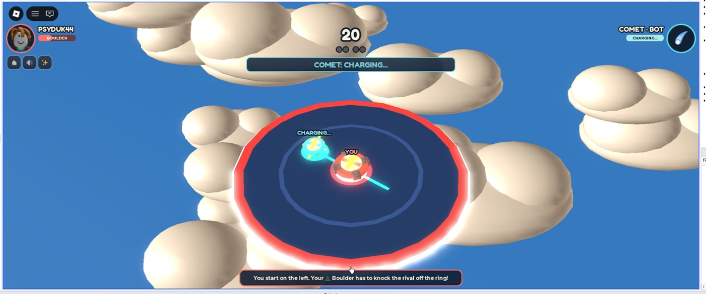

# Sky Battle

Pick a spinning top, drop it on a platform in the sky, and knock your rival off. Last top on the ring wins the round; first to two rounds wins the match. There is no health bar: how close a top is to the edge is how much trouble it is in.

**October 11, 2026: the game changed.** Sky Battle was a plane auto-battler with eight attacks, twenty wild cards and armor. Playtest feedback was that a fight was too complicated to follow, so the fight was replaced with the ring-out game described here. The match flow, draft, rewards, saving, hangar and cosmetics are unchanged. This source is **not published**; the Skybound Test place is still version 23, the plane fight. The rules are in [the combat contract](docs/COMBAT-CONTRACT.md), the numbers in [the balance report](docs/BALANCE-REPORT.md), and what has and has not been checked in [VALIDATION.md](VALIDATION.md).



## Play

Build with the commands below, then open **`build/Sky-Battle-Playtest.rbxlx` from this checkout** in Roblox Studio. Press Studio **Play**, then the hangar's main **PLAY** button. The expected flow is **rival search → pick a top → first-to-two ring-out match**.

A human searching in the same server joins immediately; after eight seconds alone you get a named, clearly labelled bot. A pilot's first match is guided: it starts at once against a bot with a Boulder against a Bolt, and the picks that follow offer a short hand.

- **Four tops.** Boulder is big and heavy. Bolt is light, charges up and dashes. Cyclone is fast and swoops in. Pogo jumps and lands with a shockwave. Every top chases its rival by itself; nobody steers during a round.
- **Six upgrades.** Heavy Core, Spikes, Turbo, Claws, Spring Bumper and Jetpack. Each winner-decided round opens one upgrade slot, up to two. New picks stay hidden until both pilots lock, then reveal together. Anything already chosen can be swapped.
- **The ring closes.** After 8 seconds the platform starts to shrink, and bumps get harder as the round goes on. A round cannot last longer than 26 seconds; one that somehow reaches the limit goes to the top nearer the middle.
- **Same rival:** REMATCH requires both humans. Next opponent searches again. The hangar's **Challenge a pilot** invites someone in the same server.
- **Automatic participation counts.** A qualifying completion gives 50 coins, plus 25 for a win. See [the eligibility rules](docs/ECONOMY-CONTRACT.md).
- **Paint and trail carry over.** A top wears its pilot's paint and leaves their trail. The hangar's planes and legendary mounts are still there and still cosmetic, but they are not shown in the fight any more; that is an open question for the hangar, not a bug.

The fight and progression are server-owned. Clients cannot choose the rival's cards, fabricate a reward, alter the simulation clock or buy power. No Robux purchase path is enabled.

## Build and checks

Packaging uses Python's standard library:

```sh
python3 scripts/build.py
python3 scripts/validate_package.py --manifest docs/validation/sky-battle-build.json
python3 scripts/validate_package.py --place build/Sky-Battle-Playtest.rbxlx
```

The default build refreshes both canonical `Skybound.rbxlx` and the byte-identical `build/Sky-Battle-Playtest.rbxlx`, and prints the exact absolute path to open. Stop old Play sessions and reopen that file after **every rebuild**; Studio does not reload an already-open document when its disk file changes. Keep edits in `src/` and `tests/`; regenerating the place replaces manual edits. `--output /path/to/place.rbxlx` builds only that alternative output. Building does not publish or update an existing Roblox experience.

The package check requires every source/spec to match the generated place exactly, rejects an enabled serialized `DistanceModeEnabled` attribute, and rejects retained experimental/fixed-seed flags or installed network QA fixtures. Packaged test ModuleScripts remain allowed. Passing this check proves the artifact's contents; a handoff also requires opening that exact candidate and visually verifying the PLAY flow above.

Offline checks use optional `lupa` (the existing environment is `build/testenv/bin/python`):

```sh
build/testenv/bin/python scripts/sample_battle.py --tests-only
build/testenv/bin/python scripts/test_server.py
build/testenv/bin/python scripts/sample_battle.py --samples 60 --upgrades
```

The sampler runs the pure specs, then every top against every top in both seats; `--upgrades` adds each upgrade against a bare top. `scripts/qa/ring_feel.py` is the same measurement with `NAME=value` overrides for tuning. [Balance report](docs/BALANCE-REPORT.md) records the latest numbers; they describe the simulation, not whether people enjoy it.

Native Studio **server** command-bar checks during Play:

```lua
local t=game.ServerStorage
local s=game.ReplicatedStorage.FlightGame
local c=game.StarterPlayer.StarterPlayerScripts
print(require(t.BattleSimulationTests)(require(s.BattleSimulation),require(s.SkillCatalog),require(s.BattleSkills)))
print(require(t.SkillCatalogTests)(require(s.SkillCatalog)))
print(require(t.MountVisualsTests)(require(s.World)))
print(require(t.BattleMatchTests)(require(game.ServerScriptService.BattleLab),require(s.SkillCatalog)))
print(require(t.PlayerStatsTests)(require(game.ServerScriptService.PlayerStats)))
print(require(t.CosmeticCatalogTests)(require(s.CosmeticCatalog)))
print(require(t.TelemetryTests)(require(game.ServerScriptService.Telemetry)))
print(require(t.BattleViewTests)(require(c.BattleView),require(s.World),require(s.BattleSimulation)))
print(require(t.BattleAudioTests)(require(c.BattleAudio)))
print(require(t.BattleClientTests)(require(c.BattleLab)))
```

Presentation test fixtures temporarily use the camera. Restart Play afterward before visual testing. Native module checks still use controlled fixtures; separate clients and physical devices are required for network and usability claims.

Studio-only diagnostics: `game.ServerStorage.FlightDebug:Invoke("battleSnapshot")`, `"battleTelemetry"`, `"snapshot"`, `"snapshots"`, or `"battleCommand"` with `{userId=...,payload={...}}`. The diagnostic command follows normal validation. Set `FlightServer.BattleFixedSeed` to a number **before Play** only for reproducibility; it disables rewards. Studio never writes the live player-data store.

For an isolated Studio roster experiment, set `BattleExperimental=true`, `BattleExperimentalVersion`, and comma-separated `BattleExperimentalOffences`/`BattleExperimentalWilds` on `FlightServer` before Play. Only registered skills are eligible; invalid pools are refused, pool fingerprints isolate queues, and experiment rewards are disabled. Published servers ignore this override. Clear these attributes for the release candidate.

## Code map

| Area | Source |
| --- | --- |
| Tops, upgrades and build rules | `src/shared/SkillCatalog.luau` |
| What each top and upgrade is made of; the ring-out physics | `BattleSkills.luau`, `BattleSimulation.luau`; [combat contract](docs/COMBAT-CONTRACT.md) |
| Queues, invitations, hidden draft, caps and authoritative results | `src/server/BattleLab.luau` |
| Profiles, fenced saving, reward receipts and cosmetic/mastery progression | `src/server/PlayerStats.luau` |
| Main integration and bounded replay funnel | `src/server/Main.server.luau`, `Telemetry.luau` |
| Draft, reveal, result, reward and replay interface | `src/client/BattleLab.luau` |
| The platform, the tops, hits and falls | `src/client/BattleView.luau` |
| Shared sound vocabulary and combat audio | `src/client/BattleAudio.luau` |
| Same-server invitation interface | `src/client/ChallengePanel.luau` |
| Cosmetic preview, goal selection and hangar | `EffectsShop.luau`, `HangarBay.luau`, `World.luau` |

The versioned replay funnel separates button requests from actual next launches, and records mode, bot/human, device, cohort, roster, stage abandonment and phase timing. Studio/developer diagnostics are not retention cohorts. The [playtest sheet](docs/SKY-BATTLE-PLAYTEST.md) defines a 12–20 unfamiliar-player discovery cohort and predeclared iteration thresholds. Analytics service limits can drop submissions; use the bounded Studio diagnostic record for controlled event-order verification.

The earlier distance-flight mode remains disabled by default. Its explicit opt-in regression coverage and source remain in [the archived reference](docs/DISTANCE-FLIGHT-REFERENCE.md). Battle play and cosmetics do not revive that mode.
