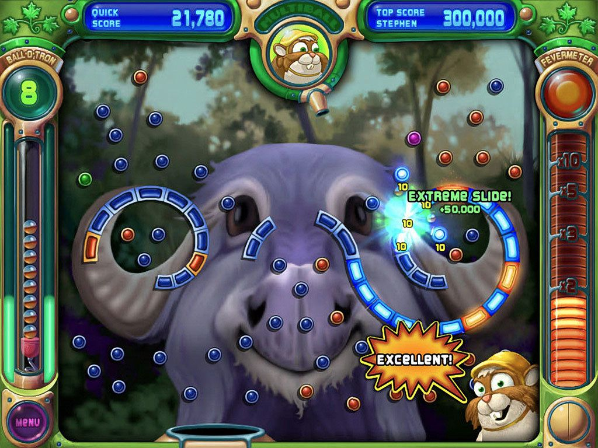
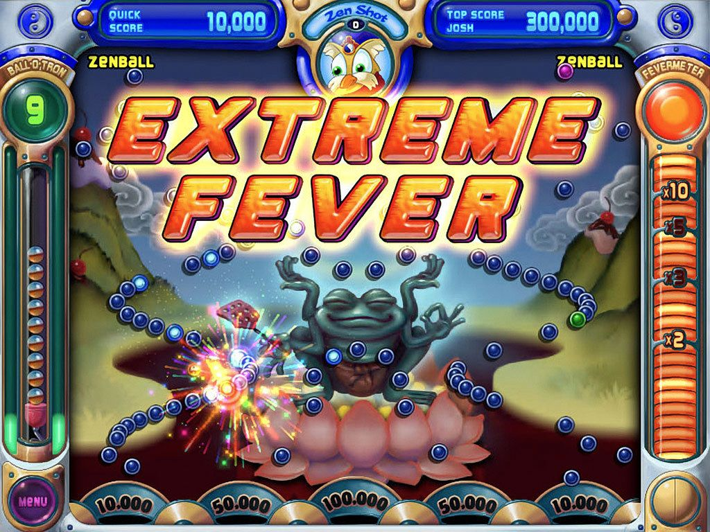
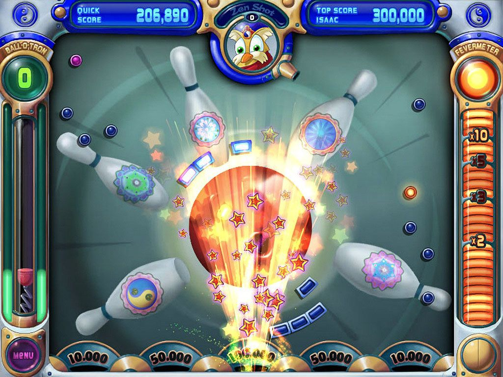
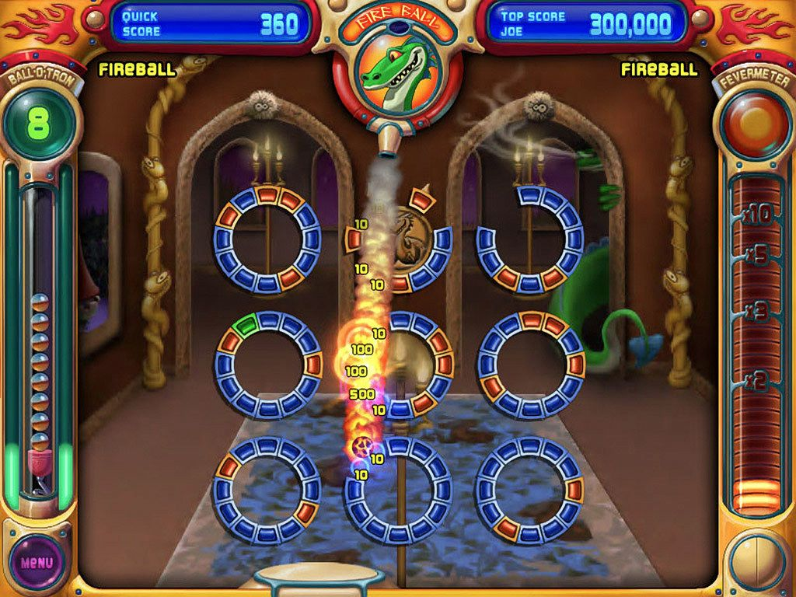
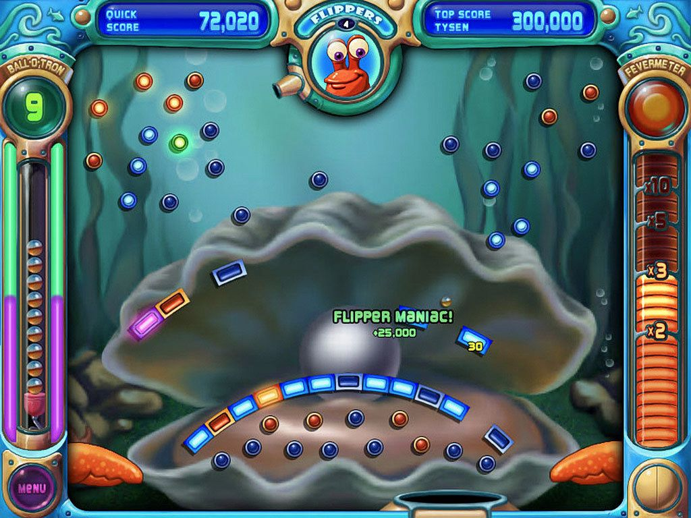
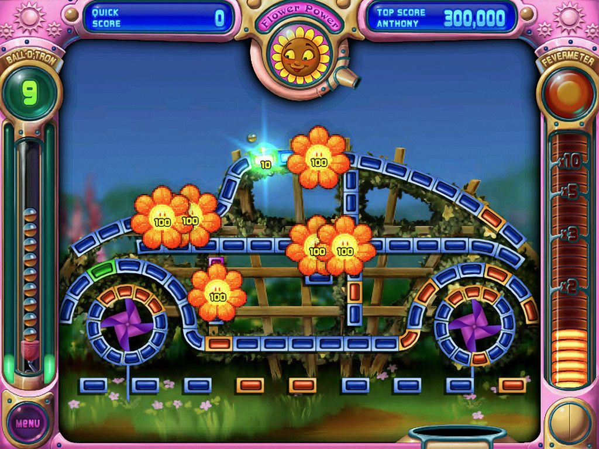
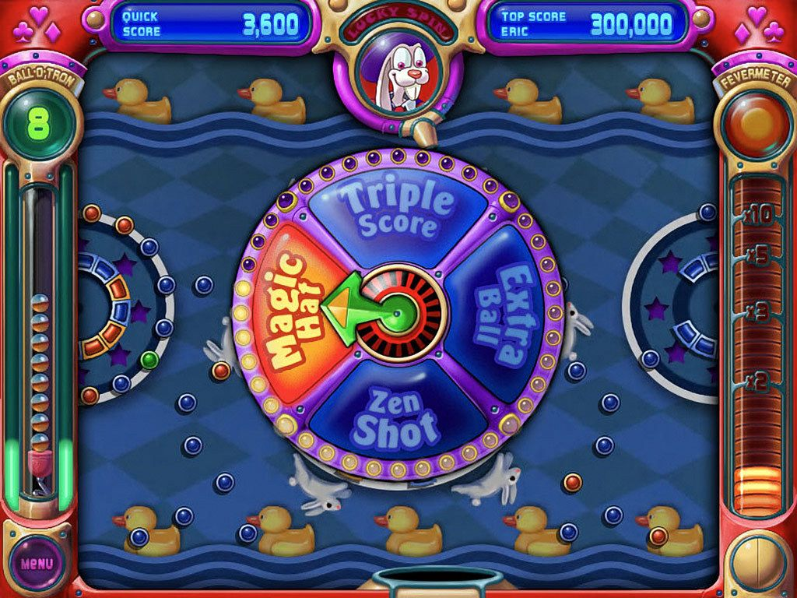
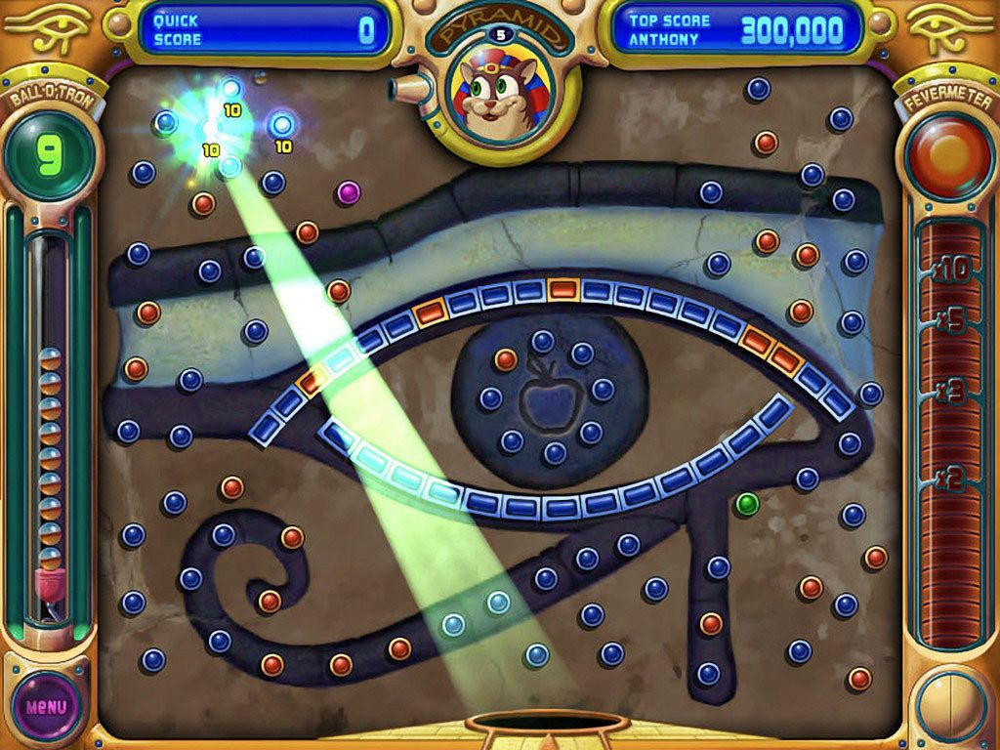
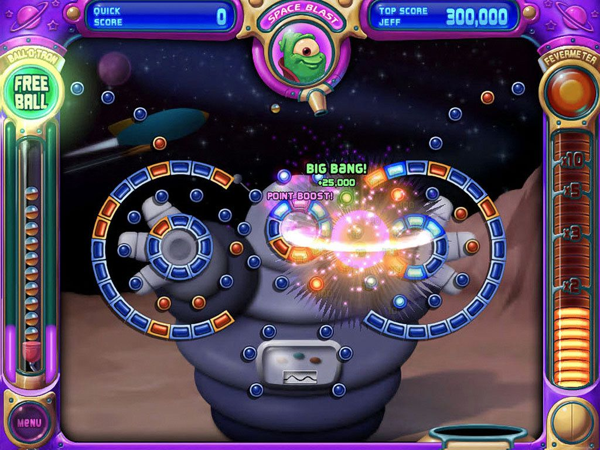

# Peggle reference and one shot duel baseline

Research checked October 9, 2026. Start with a close reference for the shot itself: a fixed board, deliberate aiming, satisfying rebounds, readable scoring and a strong finish. Build the proposed simultaneous one-shot competition around that foundation. Use original characters, artwork, sounds and board arrangements; the captured images are design references.

## Evidence and limits

Nine browser captures of the publisher's [Steam screenshot gallery](https://store.steampowered.com/app/3480/Peggle_Deluxe/) are saved below, with their original URLs in [sources.json](references/peggle/sources.json). These are published gameplay images, not captures from a locally played session. They establish visual composition, not motion timing or audio.

The rules below come from the **Example Embodiment** in [PopCap's technical description](https://patents.google.com/patent/US8398476B1/en), especially Game Play, Magic Powers, Duel Mode and Scoring. Treat it as developer documentation rather than verification of a particular installed build. Physics constants, normal aiming-guide length, sound envelopes and animation durations remain unmeasured.

## Documented rules to use as reference

| Element | Peggle reference |
| --- | --- |
| Standard objective | Ten starting balls; clear 25 orange targets. |
| Base values | Blue and green 10; orange 100; purple 500. |
| Hit targets | Normally remain lit and collidable until shot completion; stuck-ball recovery and some powers remove them earlier. |
| Shot score | Sum of awarded peg values multiplied by distinct pegs hit. |
| Orange progression | At 10/15/19/22 orange hits, multiplier becomes 2/3/5/10. It can change during a shot. |
| Original Duel | Alternating shots on a shared board; five balls each. |
| Bucket in Duel | Awards points instead of another ball. |

These distinctions matter: our one-shot simultaneous competition is an adaptation, and the original long-board progression should not be carried across without tuning. [Rules source](https://patents.google.com/patent/US8398476B1/en)

## Starting powers

| Working name | Peggle reference | Proposed first version |
| --- | --- | --- |
| **Split Shot** | Multiball adds a ball at the green peg immediately. | One activation creates one additional ball. Both contribute to one score; each target scores once across the pair. |
| **Pulse Pop** | Space Blast immediately lights nearby pegs. | A clearly outlined burst affects a compact cluster. Show its reach while aiming at the trigger. |
| **Second Wind** | Spooky Ball returns from bottom to top at the same horizontal position. | One visible portal return; no repeated looping. Show the armed return and temporarily cap the bucket so an early catch cannot prevent it; reopen the bucket after returning. |

All three original powers affect the activating shot. Fireball takes effect on the next shot, so defer it or explicitly redesign its activation. [Power behavior source](https://patents.google.com/patent/US8398476B1/en)

Working names can change after testing. Give both players the same power while validating scoring, then allow free selection among the three. Use one reachable green trigger per board initially. That gives the player a clear choice between activating a power and aiming for another valuable route. The activation cap and single trigger are our pacing choices.

## Proposed baseline for our game

### Board and aiming

Use a fixed, front-facing board with the entire playfield visible. Reserve the center for the ball and targets; put player scores and power state around its edges. Keep the opponent's score visible without forcing two tiny boards onto a phone screen.

Start with one original layout of roughly 60 to 80 targets. Include a broad curved track, an accessible cluster and a harder bank-shot route. Put the power trigger high enough to influence much of the shot. Avoid inaccessible pockets and long stretches with no contacts.

Aim changes direction only; launch speed stays fixed. Provide a short dotted ballistic preview without revealing the complete bounce sequence. Desktop dragging, touch dragging and small keyboard adjustments should control the same aim. Release locks the angle, with a prominent confirm control to prevent accidental mobile shots.

The target count and guide behavior here are proposed settings. Tune the first layout before adding board variety.

### Round and scoring

Both players receive matching layouts, target roles, initial conditions and bucket phase. Launch together after both confirm or the shared aiming window ends. Their boards resolve independently, with no collisions between opponents' balls.

Start with the documented base peg values and shot formula so we have a stable comparison. Keep the orange thresholds available as reference settings, then test a compressed per-shot progression such as 3/6/9/12 valuable targets. Those smaller thresholds are experimental, not Peggle values. Display the actual subtotal and hit count so the final score is understandable.

Use the moving bucket as a modest score bonus in this format. Initially test a catch bonus worth 10% of the shot's peg score, capped once per shot; this is our rule and needs balance testing. A catch should feel good without automatically deciding a duel.

Begin with one round and immediate rematch. Aim for roughly 5 to 8 seconds of selection/aiming and 8 to 15 seconds of motion, allowing early lock-in. Measure the tail of the duration distribution, especially with Second Wind. Tune geometry and bounce energy before imposing abrupt endings. Any eventual hard limit must be shared, visible and tested for its effect on powers.

### Feedback and finish

Make the ball the brightest small moving object. Give every first target hit a clear lighting change, short sound and readable value. Let consecutive hits build a musical phrase; group dense bursts so they do not become a wall of noise. Give each power its own activation sound and recognizable effect shape.

Build toward a larger finish: settle the final score, emphasize the winning margin and play a short original victory sting. Save zoom, slow motion and the largest burst for an exceptional shot or decisive result. Provide reduced-motion behavior and preserve ball visibility during effects.

PopCap's Andrew Stein describes audio as a carefully developed part of its games and singles out Peggle's final-target music. That supports budgeting for sound early; exact pitches and durations above remain our design choices. [Developer interview](https://www.windowscentral.com/xbox-live-developer-interview-popcap-games-makers-plants-vs-zombies)

### First playable slice

1. Build a repeatable shot test on one fixed board. Tune gravity, launch speed, collision response and target spacing together.
2. Add lighting, scoring and sound before judging whether the shot is satisfying.
3. Add Pulse Pop, then Split Shot, then Second Wind. Compare activation frequency, scores and shot duration on the same board.
4. Add the simultaneous duel presentation and rematch. Check that identical inputs under identical conditions reproduce outcomes.
5. Observe whether players can explain their result, deliberately adjust their next aim and voluntarily rematch. Verify mobile readability and two-client behavior in Roblox.

The initial slice should answer whether the shot feels good and supports intentional improvement. More powers, progression and cosmetic expansion follow that result.

## Captured visual references

All images below are cropped browser captures of the official Steam gallery. Original source links and capture time are in the accompanying manifest.

### Curved tracks and score feedback

Circular pegs, curved brick tracks, illuminated hits, nearby point labels and an unobstructed central board.

### Final celebration

Large text, concentrated particles and bottom scoring bins visibly distinguish the climax.

### End of shot flourish

### Piercing power visual

### Flippers and lower board geometry

### Distributed target feedback

### Large power overlay

This overlay obscures much of the board; our proposed starting powers avoid a separate selection interruption during flight.

### Bucket modification

### Area power activation

The visible ring, illuminated cluster and central burst are useful references for Pulse Pop's feedback.

