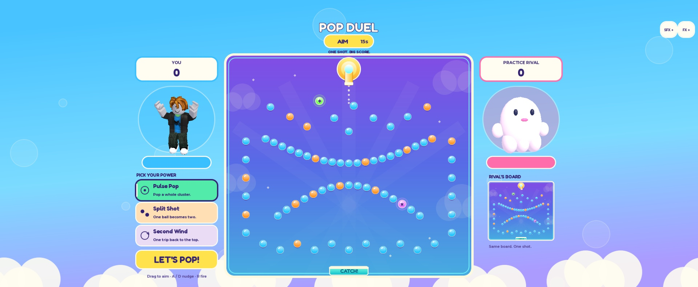

# Pop Duel validation

Recorded validation: October 9, 2026. `PopDuel.rbxlx` is the sole active project in this repository. The retired flight prototype is recoverable from Git at commit `85db5d1`. Reference research and deliberate changes to the Peggle formula are recorded in [PEGGLE-BASELINE.md](PEGGLE-BASELINE.md).

## Implemented baseline

- One aimed shot per player, identical separate boards, simultaneous launch, and the highest server score wins. A human duel requires two players; solo practice has one explicitly named ghost using the same simulation.
- A fixed board view with gravity, swept circle collisions, visible aiming guide, bouncing balls, illuminated targets, multiplier feedback, and a moving catch bucket. Hit pegs normally stay solid; a stuck-ball escape removes nearby already-hit pegs to keep the shot moving.
- Three free powers activate once when green is hit: Pulse Pop scores a nearby cluster, Split Shot adds one ball sharing the shot's score, and Second Wind returns the ball through the top once.
- Bright sky-and-candy presentation with glossy targets, a cream/cyan cabinet rim, a yellow toy launcher, and bounded pooled hit effects. The scenery uses original native UI shapes; physics and target positions are unchanged.
- Full-body live-character clones flank the board on desktop and move above it in portrait. Practice uses a distinct ghost mascot. Presenters replace old copies and clean up their models and connections; reduced FX also suppresses avatar motion, trails, flashes, sparks, and celebration confetti.
- Fifteen seconds to aim, a two-second shared countdown, and a 25-second shot safety limit. Results offer rematch or lobby and expire after 90 seconds. Human rematches need both votes; practice needs one.
- Server-controlled settings, physics, scores, and results. Leaving during a shot forfeits even when ahead; leaving before launch cancels the pairing. Separate matches do not share shot state.
- Session-only statistics in all environments. `wins` counts human-duel wins; `practiceWins` is separate. Practice can improve `bestScore` and increments total `rounds` plus `practiceRounds`. Abandoned rounds cannot establish a best score. Rejoining resets statistics. The game does not access persistent datastores or an economy.

## Source checks

The baseline implementation passed the following recorded checks using Python with the optional `lupa` dependency:

| Command | Result |
| --- | --- |
| `python scripts/test_peg_sim.py` | Catalog checks and 15 deterministic simulation scenarios passed: collision sweeps, gravity, scoring, green powers, bucket/return behavior, preview, invalid values, stuck release, and bounded completion. |
| `python scripts/test_peg_server.py` | 15 service-double scenarios passed using the actual simulation: FIFO pairing, separate duels, honest ghost replay, equal-shot ties, atomic settings validation, input/score spoof rejection, lock/deadline handling, stale match/round IDs, forfeits, disconnects, rematches, respawns, nearby prompts, throttling, and session-only data. |

The server checks exercise the real server script with in-memory Roblox service doubles. They do not establish real network replication, device performance, avatar behavior, visual readability, audible quality, or player enjoyment. The tests find an actual winning practice shot from deterministic candidates so win accounting does not depend on one balance-specific launch angle. The forfeit scenario leaves while a player is genuinely ahead on the server's score.

After retiring the flight prototype, both suites passed again using only the retained Pop Duel files. `scripts/build.py` is now the sole place builder. The saved Studio place and a fresh source build contain exactly the same eight production scripts, with no embedded test modules or temporary QA scripts. A final native-input Studio practice round selected Split Shot, launched, and reached visible results with the player avatar and practice ghost loaded. Local documentation links and whitespace checks also passed.

## Final deterministic shot sample

`python scripts/test_peg_sim.py --sweep` evaluates seed **49351** at every integer launch angle from **−65° to +65°** for each of the three powers: **131 shots per power, 393 total**. Final tuning used peg radius 14, restitution 0.75, and a 0.75-second stuck-release threshold.

| Power | Median duration | 90th percentile | Maximum | Hard timeouts |
| --- | ---: | ---: | ---: | ---: |
| Pulse Pop | 9.78 s | 13.32 s | 15.40 s | 0 / 131 |
| Split Shot | 10.28 s | 13.51 s | 15.40 s | 0 / 131 |
| Second Wind | 10.46 s | 17.12 s | 24.09 s | 0 / 131 |

This is a single-seed simulation sample, not evidence of power balance or player engagement. Split Shot produced the highest sampled scores; different seeds, intentional player strategies, real multiplayer play, and repeat-play interest still need testing. The measured duration includes the ball simulation only, excluding aiming, countdown, and results.

## Studio and player validation

The final simulation and catalog tests also passed inside actual Studio Luau. In Play mode, the lobby, practice launch, scoring, results, and practice statistics ran without runtime errors. Split Shot activated on green and produced two live balls. Second Wind activated and returned the ball through the top.

Native mouse and simulated touch were checked against the visible green target. An inset subtraction bug found during this check was fixed: both input types now use `InputObject.Position` directly against the board's `AbsolutePosition`. The resulting server angles were -42.93 degrees on desktop and -43.24 degrees in the phone simulator, consistent with the clicked target. [Roblox documents the shared coordinate system here](https://create.roblox.com/docs/reference/engine/classes/GuiBase2d#AbsolutePosition).

The refreshed bright desktop composition and iPhone 17 Pro landscape/portrait layouts were visually checked in actual Studio. Full-body characters and the distinct practice ghost remain visible alongside the board or above it in portrait. The match backdrop covers the safe-area margins; powers and LET'S POP! remain reachable. `StarterGui.ScreenOrientation` is `Sensor`, allowing both phone orientations. Native simulator taps selected Second Wind and locked the shot during baseline validation; the refreshed landscape controls also selected Split Shot and locked the shot, confirmed by the server. This establishes simulated touch behavior, not physical-device performance.

Two consecutive practice rematches retained exactly one model per avatar presenter; returning to the lobby cleared the rival presenter. A live server respawn replaced the displayed character with the new marked character and retained exactly one model. The baseline multiplayer replication results below predate this avatar presentation update.

All 16 pooled sound instances loaded successfully. Audible mix quality and player enjoyment still need a human playtest. No published-server test or power-balance claim has been made.

### Actual two-client replication check

Studio's [multiplayer test service](https://create.roblox.com/docs/reference/engine/classes/StudioTestService) launched one server and two separate player clients. Temporary QA scripts drove the real Command/Snapshot RemoteEvents through joining, readying, simultaneous shots, results, and a mutually accepted rematch. Both clients reported the same seed, scores, settings, and winner as the authoritative server. The two rounds completed successfully in 36.09 seconds:

| Round | Board seed | Player 1 | Player 2 | Result |
| --- | ---: | ---: | ---: | --- |
| 1 | 116219 | Pulse Pop, -48 degrees: 6,600 | Split Shot, -42 degrees: 66,000 | Player 2 won; both clients agreed. |
| 2 | 119790 | Pulse Pop, -45 degrees: 38,190 | Pulse Pop, -45 degrees: 38,190 | Exact tie; both clients agreed. |

[Captured structured result](screenshots/pop-duel-network-qa.json). The harness also verified both clients observed Aim/Countdown/Shot/Results, both shots began with matching elapsed times, no ghost entered the human match, and completed-round counts were exactly two. Temporary scripts were removed from the editor afterward and are excluded from the place builder. This is local client/server replication evidence; it does not establish internet latency behavior or published performance.

The multiplayer sessions also emitted Roblox's legacy `ChatScript`/`CoreGuiChatConnections` startup error and avatar mesh warnings inherited from the Studio environment. The Pop Duel scripts completed the test successfully. These engine/core-script messages remain separate from the prototype's validation.

### Bright presentation and avatar multiplayer check

The final presentation passed the same two-client flow in 36 seconds, including a rematch and equal-shot tie. At both results, both clients verified their own and their opponent's avatar: the correct user ID, a live-character source, matching head and accessory signatures, and exactly one model per presenter. Both characters were also visibly present in the [actual multiplayer screenshot](screenshots/pop-duel-bright-two-player.jpg). [Structured avatar results](screenshots/pop-duel-avatar-network-qa.json) preserve all eight panel checks.

The first launch attempt timed out because Studio opened one test client in Edit mode instead of joining; a fresh launch succeeded without production changes. Temporary QA scripts were removed before saving. Desktop and both simulated phone orientations were checked; this does not establish physical-device or published-server performance.

[Bright phone layout](screenshots/pop-duel-bright-phone.jpg)

The Studio-only server diagnostic is `game.ServerStorage.PegDebug`; `Invoke("snapshot")` reads the first player's authoritative snapshot. It also accepts `snapshots`, `start`, `command`, `launch`, and `advance`. This BindableFunction is omitted outside Studio and is not exposed to clients.
