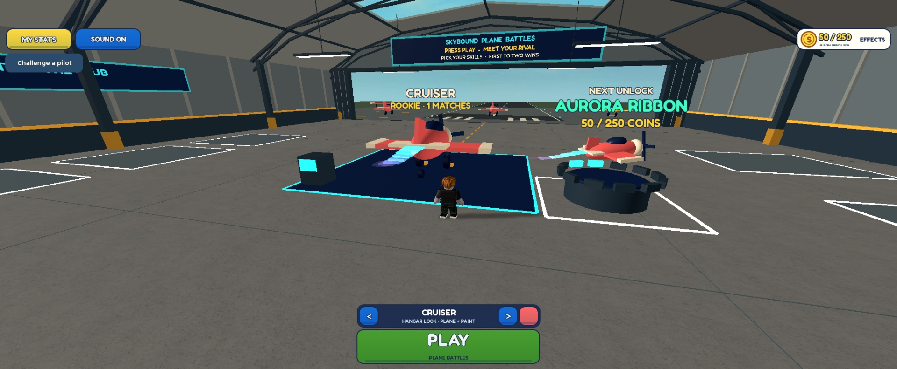
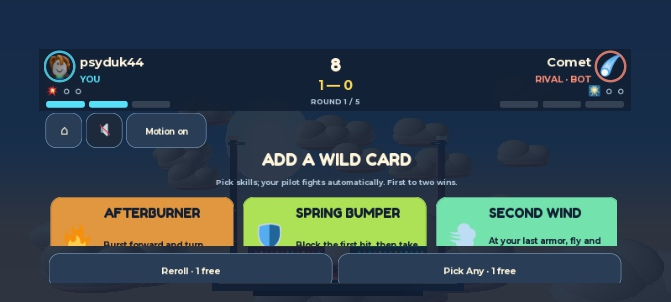
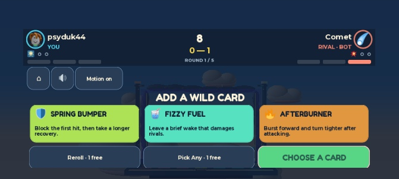

# Sky Battle QA — October 10, 2026

**Verdict: the corrected local PvP candidate passes this local QA round. Release approval remains open.** I used actual Studio mouse/keyboard input, inspected rendered screens, completed matches, reproduced defects, fixed them, and reran native and two-client checks. Automated mechanics and emulated screens do not establish human enjoyment, physical-phone quality, heard audio quality, or published persistence.

## Limited-test publication — October 10, 2026

**Skybound Test version 6 is published**, place `86507299893768`, universe `10770074500`, from source commit **`a0c9d9eafa08a9bc5624641837ee59c824b3021d`**. Native Studio confirmed “Published new changes” and Playtester availability at **2026-10-10T18:14:58Z** (11:14:58 PDT). Creator Dashboard showed version 6 at 11:14; version 5 at 11:13 was the preceding autosave. Access was confirmed **Limited**, **Playtesters enabled**, **Friends disabled**. [Version-history evidence](validation/qa-2026-10-10/published-version-6.jpg). This supersedes the earlier unpublished local handoff described below.

After Publish As stalled before upload, the verified source was applied to the existing cloud place and published directly. Before publication, all **35 script sources** matched the verified candidate; required remotes and clean gameplay attributes, an empty authored world, Sensor orientation and native visual lighting properties were checked. The protected lighting migration metadata `RBX_OriginalTechnologyOnFileLoad` remains `1` in the cloud place versus `2` in the reference. Therefore this is source/visual-property parity, **not byte-identical native-artifact publication**; the recorded XML SHA-256 identifies the local candidate only.

Publication does not close the physical-phone, heard-audio, published two-independent-account gameplay, live persistence/rejoin or unfamiliar-player/balance gates. The 200 native checks, five bot matches and two-client run below remain local, session-only evidence. [Current publication manifest](validation/sky-battle-build.json) and [published playtest record](SKY-BATTLE-PLAYTEST.md).

## Build and handoff

The distance-mode report was real: the running Studio window was the older `.claude/worktrees/hanger-redesign-proposals-7173ca/Skybound.rbxlx`. Its result screen said “FURTHEST FLIGHT WINS,” and its loaded source lacked the current BattleLab server and distance-mode gate. The canonical source had not reverted. The handoff failed to verify the exact running window.

That old session was stopped without editing or saving it. The default build now emits a clearly named playtest copy and prints its absolute launch path:

`/Users/andrew/Documents/ChatGPT/color-switch/build/Sky-Battle-Playtest.rbxlx`

This file and the canonical `Skybound.rbxlx` are byte-identical, with 35 packaged scripts matching source. SHA-256:

`b0280d3c5a037e5364d260e488770a0bd84d5c73b1be7fa699c7c32c4f2d80db`

The final native run used **Sky-Battle-Playtest.rbxlx** (Studio ID `94501ad0-410e-44f6-9428-9b832e6dea49`). All 35 Edit sources were synchronized and compared with the generated file before the final tests. At the end of local QA, the session was left in the PvP hangar, at desktop size, with controls enabled and 50 coins; no network QA fixtures remained. The console contained the two expected readiness messages and no game-script errors. That was the pre-publication local handoff; version 6 above is the subsequent limited-test publication. Older open Studio tabs are not the verified candidate.

## Reproduced defects and fixes

| Issue | Failure | Fix and verification |
| --- | --- | --- |
| [AND-223](https://linear.app/pitter-app/issue/AND-223/keep-lock-in-and-card-descriptions-visible-on-short-landscape-phones) | Galaxy A06 landscape hid Lock In and clipped card promises. | Compact landscape header/cards and a fixed 44px action row. Actual Firework selection and Lock reached Countdown with Firework on the corrected layout. |
| [AND-224](https://linear.app/pitter-app/issue/AND-224/prevent-reroll-races-from-locking-a-different-card) | Reroll followed by an old-card click and Lock could commit a replacement card the player did not choose. | Private offer revisions, explicit selected skill on lock, and client controls disabled pending the offer response. Native server and real paced-client-outbox regressions reject stale/bare locks; final UI reroll → Pick Any → Pinball → Lock worked. |
| [AND-225](https://linear.app/pitter-app/issue/AND-225/recover-initial-profile-load-failures-safely-during-the-session) | An initial transient load failure or occupied lease left progression unavailable for the entire session. | Bounded retry with fenced lease acquisition, preserved durable history and one-time pending-outcome replay. Native and service-double recovery cases pass; live cloud recovery is still unverified. |
| [AND-226](https://linear.app/pitter-app/issue/AND-226/reset-a-quitters-win-streak-without-granting-completion-rewards) | Quitting a losing match preserved the current win streak. | Public abandonment resets the quitter's streak without coins, mastery or completion credit. Native win → abandon → win and duplicate cases pass; diagnostic matches remain isolated. |
| [AND-227](https://linear.app/pitter-app/issue/AND-227/explain-armor-timeout-match-victories-using-the-deciding-round) | An observed 2–0 armor-timeout victory credited the rival's last hit without explaining the win. | Preserve the deciding-round reason in terminal results; native timeout regression verifies the armor explanation. A normal timeout-result visual recheck after the fix remains open. |
| [AND-228](https://linear.app/pitter-app/issue/AND-228/show-the-authoritative-fight-deadline-after-server-stalls) | After bounded simulation catch-up, the displayed timer could disagree with the server's wall-clock timeout. | HUD uses the synchronized fight deadline and earlier match cap. Native regression displays the real 3 seconds left despite stale simulation elapsed time; both players receive the same deadline. |
| [AND-229](https://linear.app/pitter-app/issue/AND-229/disable-lobby-movement-while-battle-stats-are-open) | Holding W for 700ms with MY STATS open moved the avatar 10.67 studs behind the modal. | Stats joins the modal movement gate. The same actual input moved 0 studs on the final build; closing Stats restored controls. |

These seven fixes are **In Review** in Linear. The handoff fix also adds package rejection for enabled distance mode, diagnostic overrides and installed multiplayer QA scripts. It does not remove the archived distance implementation or its explicit regression tests.

Before: the short landscape wild-card screen clipped its descriptions and hid Lock In.

After: all three actions remain visible; extra Pick Any rows scroll inside the card area.

## Actual visual and input pass

This pass completed **five normal bot matches: three wins and two losses**. Four exposed/tested the pre-fix candidate; the fifth ran after the final rebuild. Combat is automatic; I chose draft options, used the real UI, and inspected combat/results frames rather than driving an artificial winner. No diagnostic seed or outcome override was enabled.

| Run | Observed outcome and flow |
| --- | --- |
| Before fixes, match 1 | Meteor + Second Wind vs Comet's Pinball + Afterburner; 2–0 win, +75. Included an armor-timeout round. Claimed/equipped Coral Spark without spending the 75 coins. |
| Before fixes, match 2 | Used Pick Any → Firework; 2–0 win, cumulative 150. Exposed the misleading timeout-result fact. |
| Before fixes, match 3 | Machine Gun vs Meteor; 0–2 loss, +50, cumulative 200. |
| Before fixes, match 4 | Machine Gun vs Firework; 2–0 win, +75, cumulative 275. Bought Aurora for 250, observed 25 remaining, then separately equipped it. Coins were earned through those matches. |
| Final build, match 5 | Actual Firework card and Lock on A06 emulation; Firework + Spring Bumper vs Machine Gun; 0–2 loss, +50. Scrolled portrait rewards, claimed/equipped Blue Comet with 50 coins preserved. |
| Final replay and exit | Actual REMATCH retained Comet, reset score/resources, and carried Blue Comet forward. Reroll → Pick Any → Pinball → Lock reached Countdown with Pinball vs Meteor. Exit returned to a controllable hangar; PLAY → Cancel returned to that hangar again without changing the 50 coins. |

One additional partial pre-fix rematch was exited after a device-input coordinate mismatch. It is not counted as a completed match and awarded nothing.

Inspected desktop **2075×856**, iPhone 17 Pro **750×381 landscape / 401×778 portrait**, and Galaxy A06 **705×338 landscape** (usable UI root 705×280). Device emulation used mouse input, not physical touchscreen input. Collection, stats and challenge empty-state panels opened/closed; results rewards scrolled. Mute and reduced-motion settings applied and flash suppression was checked, but audio was not heard.

[Final landscape result](validation/qa-2026-10-10/a06FinalResult.jpg) · [final portrait result](validation/qa-2026-10-10/finalPortraitResult.jpg) · [portrait gift](validation/qa-2026-10-10/finalPortraitGiftScroll.jpg) · [final replay reveal](validation/qa-2026-10-10/finalRematch.jpg) · [earned Aurora purchase](validation/qa-2026-10-10/auroraPurchased.jpg) · [Aurora equipped](validation/qa-2026-10-10/auroraEquipped.jpg)

## Mechanical and network evidence

| Verification | Result and boundary |
| --- | --- |
| Native Studio suites | **200 checks passed**: simulation 40, skills 5, match orchestration 32, player stats 51, cosmetics 11, telemetry 14, presentation 12, audio 24, client commands/feedback 11. [Raw results](validation/qa-2026-10-10/native.json). Audio assertions verify behavior, not listening quality. |
| Full Main.server harness | **44 scenarios passed**: 11 default battle integrations and 33 explicitly opted-in archived distance regressions. “Published” scenarios in the log use service doubles, not a published experience. [Raw results](validation/qa-2026-10-10/server.txt). |
| Simulation suite | **40 checks passed** in the independent simulation runner. [Raw results](validation/qa-2026-10-10/simulation.txt). |
| Two real Studio clients | **10 checks passed in 74.66 seconds**, with programmatic production-remote input. Normal three-round match ended with mirrored 1–2 / 2–1 scores and 50/75 coin awards. Private picks, shared reveal/seed, starter claim, mutual rematch, departure cleanup, challenge decline/accept and final lobby restoration all passed. Captured errors: none. [Raw report](validation/qa-2026-10-10/network.json), [rendered two-client fight](validation/qa-2026-10-10/twoClientCapture.jpg). |
| Package/handoff | Both generated files validate all 35 scripts; no distance/diagnostic override or temporary network fixture. [Exact manifest](validation/sky-battle-build.json). |

The multiplayer run reports `saveStatus=session_only`. It proves two-client agreement and session awards, not cloud confirmation, human GUI play or published networking. Test fixtures were removed before the final normal UI pass. Tool success alone was not accepted as a button activation; server phase/loadout/balance was checked after input. Manual timing includes inspection delays and is not an onboarding or replay-speed benchmark.

## What still prevents release approval

- **Physical phone:** touch targets, notches/safe areas, frame stability and sustained thermal performance. Small-landscape combat still reads small in sampled frames, especially with reduced motion. The fixed draft is usable in emulation; that does not settle combat readability.
- **Published two-account session:** version 6 is now recorded, but agreement, lifecycle and same-server invitations still need verification with two independent accounts. The local QA pass below the publication update did not provide that evidence.
- **Live persistence:** confirmed grants/equipment/mastery, leave/rejoin, failure recovery and lease behavior against the actual store.
- **Audio and complete effects review:** hear the mix and published asset permissions; inspect whole-fight camera/knockout sequences and every skill tell. Frame samples and native assertions do not satisfy this. A normal draw screen and the corrected armor-timeout result were not visually reached after the final rebuild.
- **Unfamiliar-player outcomes and balance:** whether players understand their choices/results and voluntarily replay. Existing draw/stall and strong-build flags in [the balance report](BALANCE-REPORT.md) remain. Five bot matches do not prove retention or a balanced roster.
- **Minor presentation polish:** the hangar mastery label currently says “1 MATCHES.” This does not block the loop but should be corrected with the next presentation pass.

[AND-189](https://linear.app/pitter-app/issue/AND-189/first-rivalry-visual-audio-and-real-phone-playtest-audit-follow), AND-221 and [AND-222](https://linear.app/pitter-app/issue/AND-222/release-gate-published-two-player-and-real-phone-validation) remain open. Use [the published playtest checklist](SKY-BATTLE-PLAYTEST.md) to collect the missing release evidence. Milestones 1–2 are not being marked complete on the strength of this local round.
